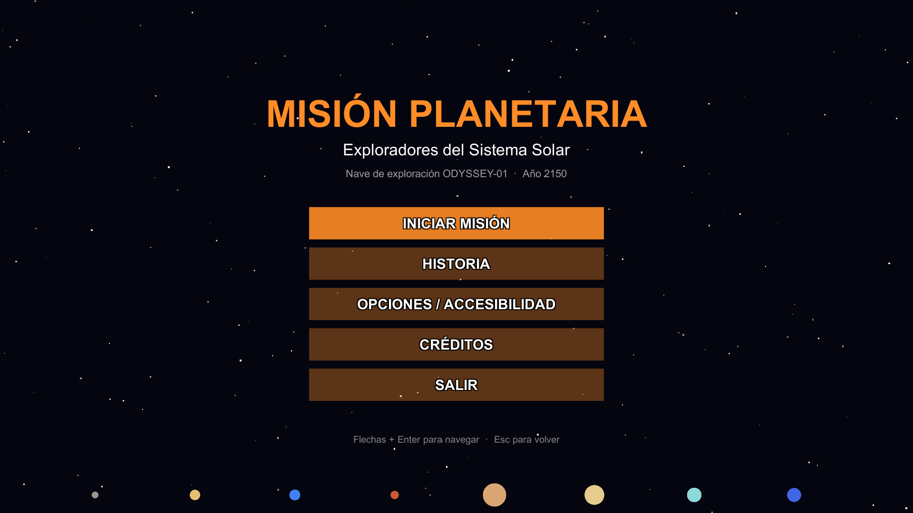
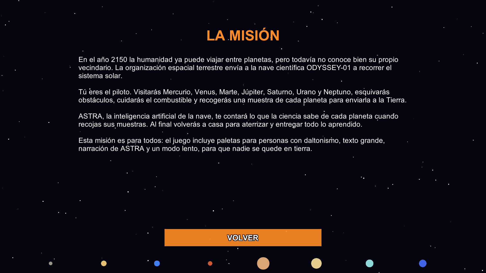
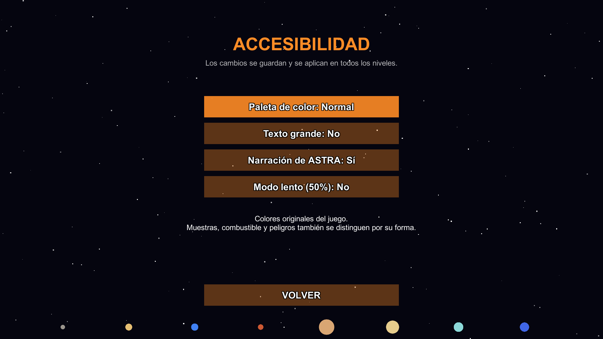
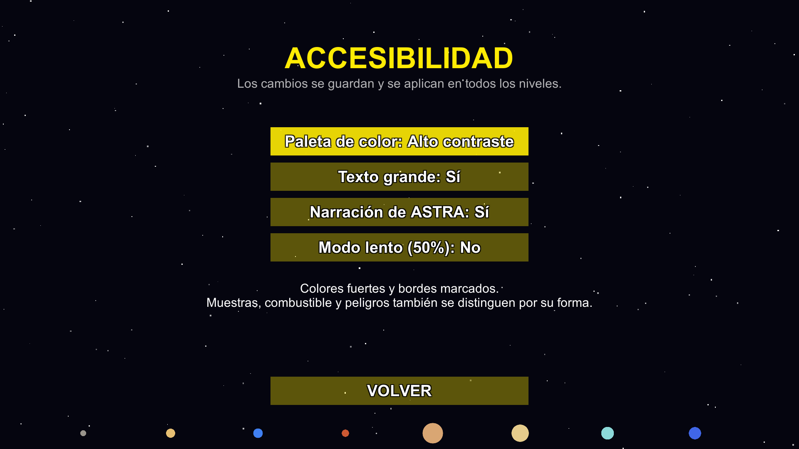
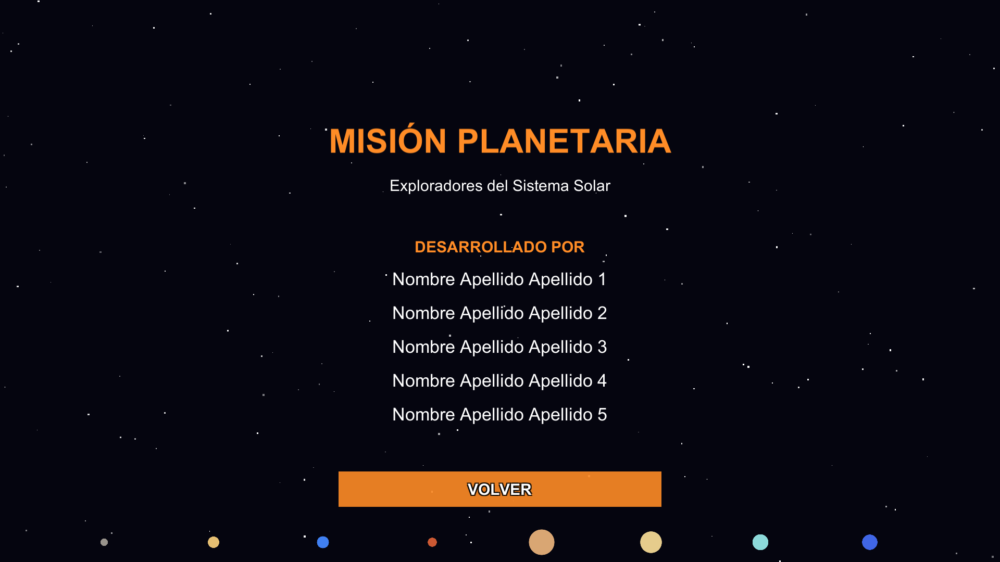

# MISIÓN PLANETARIA: Exploradores del Sistema Solar

Proyecto final del curso **IDSE — Game Developer 2026**. Videojuego en **Unity 6 (6000.3.29f1)**.

En el año 2150 la nave científica **ODYSSEY-01** recorre el sistema solar. El jugador es el piloto: esquiva obstáculos, administra el combustible y recoge una muestra de cada planeta. **ASTRA**, la IA de la nave, explica lo que la ciencia sabe de cada planeta. Al final vuelve a la Tierra para aterrizar y entregar las muestras.



## Niveles

| # | Planeta | Objetivo | Obstáculos | Dificultad |
|---|---------|----------|------------|------------|
| 1 | Mercurio (2.5D) | Muestras de roca | Cráteres y rocas estáticas | Baja |
| 2 | Venus (2.5D) | Muestras minerales | Rocas y zonas volcánicas | Media |
| 3 | Marte | Suelo marciano | Meteoritos y rocas en movimiento | Media |
| 4 | Júpiter | Partículas de nubes (sondas) | Tormentas y fragmentos móviles | Alta |
| 5 | Saturno | Hielo y polvo de los anillos | Fragmentos de hielo en movimiento | Alta |
| 6 | Urano | Partículas congeladas (sondas) | Bloques de hielo y corrientes | Alta |
| 7 | Neptuno | Muestras de atmósfera (sondas) | Tormentas y objetos móviles | Muy alta |
| 8 | Tierra | Aterrizar y entregar todo | Navegación final y aterrizaje | Final |

Cada nivel tiene un **skybox** propio con elementos reales del planeta (el Sol gigante en Mercurio, las nubes ácidas de Venus, Fobos y Deimos en Marte, la Gran Mancha Roja, los anillos de Saturno, etc.).

## Requisitos del curso (PROYECTO GAME DEVELOPER 2026)

- [ ] Entre 7 y 12 niveles
- [ ] Sonido al colisionar con combustible, obstáculos, plataforma de llegada y propulsor
- [ ] Puntaje 100% al iniciar; baja al chocar con obstáculos; máximo 5 colisiones
- [ ] Combustible = 10 al iniciar cada nivel, baja con el tiempo y el sobrante se acumula al siguiente nivel
- [ ] Obstáculos en movimiento solo en niveles superiores
- [ ] Modo 2.5D en al menos los dos primeros niveles
- [x] Guion visible relacionado con el TIF (panel **Historia**)
- [x] Ventana de créditos con los nombres completos de los autores (**faltan los nombres reales**)

**Entrega:** lunes 07/12 (semana 15), en horario de teoría.

## Responsabilidad social

- **Inclusión:** paletas para daltonismo (protanopia/deuteranopia, tritanopia, alto contraste), texto grande, narración de ASTRA y modo lento. Se configuran en el menú y se aplican en todos los niveles.
- **Educativo:** cada muestra recogida desbloquea la ficha del planeta que explica ASTRA.

## Estructura

```
Assets/
  Scripts/
    MenuPrincipal.cs    menú, historia, opciones de accesibilidad y créditos (UI construida por código)
    NaveControl.cs      propulsión (Space), giro (A/D), combustible, sonido del motor
    NaveColisiones.cs   colisiones por Tag: ColisionSegura, Combustible, Muestra, Aterrizaje, obstáculos
    PlanetaAmbiente.cs  skybox y luz del planeta de cada escena
    Accesibilidad.cs    HUD del nivel + paleta/texto/lento (F1, F2, F3)
    Capturador.cs       saca capturas del menú: MisionPlanetaria.exe -capturas <carpeta>
  Editor/
    ConstruirMenu.cs    menú "Mision Planetaria > Crear escena Menu y compilar"
  Scenes/Menu.unity
docs/capturas/          capturas del menú
```

## Cómo abrirlo

1. Clonar el repo y abrir la carpeta con Unity Hub (**Add > Add project from disk**), versión 6000.3.29f1.
2. Abrir `Assets/Scenes/Menu.unity` y darle Play.
3. Para los niveles, crear los Tags `ColisionSegura`, `Combustible`, `Muestra` y `Aterrizaje`.

## Capturas

| Historia | Accesibilidad |
|---|---|
|  |  |
| **Alto contraste + texto grande** | **Créditos** |
|  |  |
